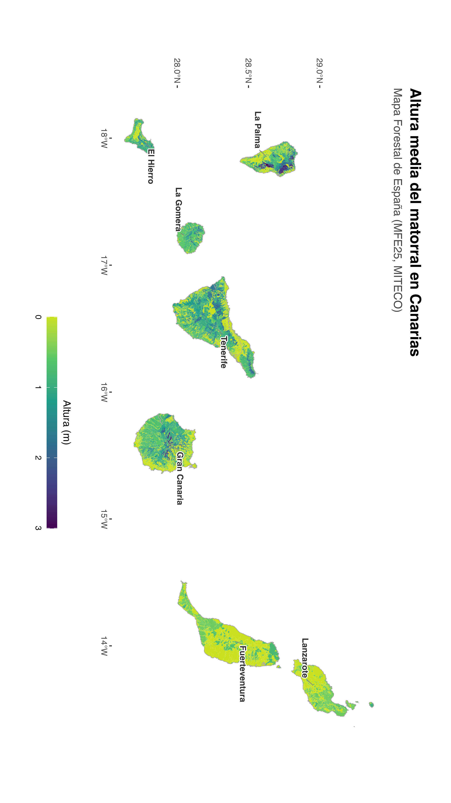

::: callout-important

🇮🇨 Distribución espacial de la altura media del matorral (HMMAT, expresada en metros) en el archipiélago de Canarias, elaborada a partir del *Mapa Forestal de España (MFEMax)* del Ministerio para la Transición Ecológica y el Reto Demográfico (MITECO). Los datos corresponden a la cartografía ajustada al modelo MFE25 (edición Canarias 2018; proyección EPSG:32628), donde los valores originales en decímetros se han transformado a metros (rango de 0 a 3 m). Se observa un marcado gradiente altitudinal y climático, con matorrales de porte bajo o nulo en las zonas áridas costeras e islas orientales (Lanzarote y Fuerteventura) y formaciones arbustivas de mayor desarrollo en las medianías y cumbres de las islas de mayor relieve (La Palma, Tenerife y Gran Canaria). Se anexaran los datos específicos de La Graciosa.
:::

```{undefined}
#| eval: false
#| message: true
#| warning: true
#| code-fold: true
#| code-summary: Haz clic aquí para ver el código
# 1. Cargar librerías necesarias
library(sf)
library(dplyr)
library(ggplot2)
library(ggrepel)

# 2. Crear silueta exterior de las islas para dibujar una línea de costa fina
costa_canarias <- st_union(st_make_valid(canarias))

# 3. Crear etiquetas con las coordenadas de las 7 islas principales
islas_df <- data.frame(
  nombre = c("La Palma", "El Hierro", "La Gomera", "Tenerife", 
             "Gran Canaria", "Fuerteventura", "Lanzarote"),
  lon = c(-17.85, -18.02, -17.22, -16.55, -15.60, -14.05, -13.63),
  lat = c( 28.67,  27.74,  28.12,  28.28,  27.96,  28.40,  29.03)
)

etiquetas_islas <- st_as_sf(islas_df, coords = c("lon", "lat"), crs = 4326) %>%
  st_transform(st_crs(canarias))

# 4. Construir el mapa completo con leyenda inferior horizontal
mapa_canarias <- ggplot(data = canarias) +
  labs(
    title = "Altura media del matorral en Canarias",
    subtitle = "Mapa Forestal de España (MFE25, MITECO) \nDistribución espacial de la altura media del matorral (HMMAT, expresada en metros) en el archipiélago \nde Canarias, elaborada a partir del Mapa Forestal de España (MFEMax) del Ministerio para la Transición Ecológica y el Reto Demográfico (MITECO). \nLos datos corresponden a la cartografía ajustada al modelo MFE25\n(edición Canarias 2018; proyección EPSG:32628), donde los valores originales en decímetros \nse han transformado a metros (rango de 0 a 3 m). Se observa un marcado gradiente altitudinal y climático, con matorrales de porte bajo o nulo en las zonas áridas costeras e islas orientales (Lanzarote y Fuerteventura) y formaciones arbustivas de mayor desarrollo en las medianías y cumbres de las islas de mayor relieve (La Palma, Tenerife y Gran Canaria). Se anexaran los datos específicos de La Graciosa.",
    x = "",
    y = "",
    fill = "Altura (m)"
  ) +
  geom_sf(aes(fill = HMMAT / 10), color = NA) +
  geom_sf(data = costa_canarias, fill = NA, color = "grey65", linewidth = 0.2) +
  scale_fill_viridis_c(
    direction = -1,
    end = 0.92
  ) +
  # Configurar la barra de leyenda en horizontal
  guides(
    fill = guide_colorbar(
      title.position = "top",
      title.hjust = 0.5,
      barwidth = unit(8, "cm"),
      barheight = unit(0.4, "cm")
    )
  ) +
  geom_text_repel(
    data = etiquetas_islas,
    aes(label = nombre, geometry = geometry),
    stat = "sf_coordinates",
    size = 3.2,
    fontface = "bold",
    color = "grey20",
    bg.color = "white",
    bg.r = 0.15,
    box.padding = 0.8,
    point.padding = 0.5,
    min.segment.length = 0.2,
    segment.color = "grey50",
    segment.size = 0.3
  ) +
  theme(
    plot.title = element_text(size = 16, face = "bold"),
    plot.subtitle = element_text(size = 12, color = "grey30"),
    legend.position = "bottom",
    panel.grid = element_blank(),
    panel.background = element_rect(fill = "white", colour = NA),
    plot.background = element_rect(fill = "white", colour = NA),
    legend.background = element_rect(fill = "white", colour = NA),
    legend.key = element_rect(fill = "white", colour = NA)
  )

# 5. Mostrar en pantalla y guardar en máxima calidad
print(mapa_canarias)

ggsave(
  filename = "mapa_altura_matorral_canarias.png",
  plot = mapa_canarias,
  width = 12,
  height = 6,
  units = "in",
  dpi = 600,
  bg = "white"
)
```


